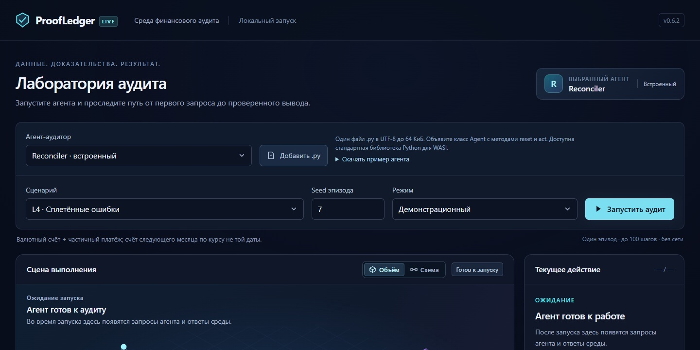

# ProofLedger Live v0.6.2

Локальная платформа для проверки агентов финансового аудита. Судья загружает скрипт, выбирает эпизод и видит на схеме, какие документы запросил агент и какими доказательствами подкрепил выводы. Все документы синтетические.

## Запуск и демо

На Windows x64 с 64-разрядным Python 3.11+ откройте [START.cmd](START.cmd) из папки проекта. В браузере появится «Лаборатория аудита». Чтобы увидеть первый прогон, оставьте встроенного агента Reconciler и нажмите **«Запустить аудит»**.

[](demo/ProofLedger-0.6.2-demo.mp4)

[Посмотреть демо (MP4)](demo/ProofLedger-0.6.2-demo.mp4) · [Записка о дизайне](DESIGN.md)

## Материалы для жюри

| Материал | Где его найти |
|---|---|
| Исходный код и зависимости | [Генератор](proofledger/generator.py), [среда](proofledger/env.py), [интерфейс жюри](judge_adapter.py), [лицензия MIT](LICENSE), [зависимости тестов](requirements.txt), [зависимости агента](requirements-judge.txt), [офлайн-пакеты](runtime/wheels/) |
| Сборка и проверка | [Dockerfile](Dockerfile). После установки зависимостей команда `python -m proofledger` запускает тесты и проверки поведения. Инструкции для контейнера приведены ниже. |
| Сопоставление и награда | [Общий оценщик](proofledger/matcher.py), [JSON-схемы](proofledger/schemas/), параметры правил каждого эпизода в его файле `policy.json` |
| Открытые эпизоды | [10 train](episodes/train/), [10 dev](episodes/dev/), [конфигурации для воспроизведения](episodes/configs.json) |
| Тесты | [Среда](tests/test_env.py), [сопоставление](tests/test_official_matcher.py), [награда](tests/test_rewards.py), [полный набор](tests/) |
| Четыре базовые политики | [RandomExplorer, Reconciler, FlagAll и Oracle](proofledger/policies.py), [сравнение через интерфейс жюри](proofledger/judge_benchmark.py) |
| Траектории | [trajectories.jsonl](episodes/trajectories.jsonl) содержит 300 шагов в 10 train-эпизодах. Наблюдения содержат только публичные данные. |
| Записка о дизайне | [Устройство среды, доступ к данным и расчёт награды](DESIGN.md) |
| Демо | [Видеозапись работы среды](demo/ProofLedger-0.6.2-demo.mp4), [примеры скриптовых агентов](proofledger/examples/) |

Сохранённые результаты по пяти уровням можно посмотреть в [отдельном HTML-отчёте](reports/levels.html), открыв его на компьютере.

## Проверка для жюри

Клонируйте репозиторий или распакуйте ZIP и перейдите в папку проекта. Рабочая директория содержит `judge_adapter.py`, `Dockerfile` и этот README. В контейнере это `/app`. Проверка на Python 3.11+ запускается одной командой после установки тестовых зависимостей.

```sh
python -m pip install --no-index --find-links=runtime/wheels -r requirements.txt
python -m proofledger
```

Для Linux-контейнера на amd64 или arm64 с заранее загруженным базовым образом `python:3.11.11-slim` обе команды выполняются без сети. В образ входят зависимости тестов и Wasmtime для проверки загруженных скриптов.

```sh
docker build --network=none -t proofledger .
docker run --rm --network=none --cpus=2 --memory=4g proofledger
```

При сборке Linux-образа компилируется поставляемый интерпретатор WASI. При первом запуске агента контейнер читает готовый модуль из образа. Следующая команда проверяет первый эпизод в свежем контейнере с лимитом 45 секунд на запуск.

```sh
docker run --rm --network=none --cpus=2 --memory=4g proofledger python -m pytest -q tests/test_judge_policy.py
```

Тесты адаптера и новых правил сопоставления запускаются командой `python -m pytest -q -k "judge or official_matcher"`. Команда `python -m proofledger.judge_benchmark` выводит P, R, F1, награду, число шагов и время для четырёх фиксированных политик на одних и тех же 20 эпизодах. Изолированный тест загружаемой политики использует Wasmtime из комплекта Windows x64 или Linux-образа. Дополнительный тест Gymnasium выполняется при наличии библиотеки.

### Подключение среды

Код ниже исполняет процесс жюри. Он владеет каталогом эпизода, seed, конфигурацией и объектом среды. Политику жюри запускает в отдельном ограниченном процессе. Через границу процессов проходят только публичные наблюдения, info, награда, флаги и JSON-действие. В `tests/test_judge_policy.py` приведён рабочий пример с отдельным процессом WASI.

```python
from tempfile import TemporaryDirectory
from judge_adapter import generate_episode, make_env, score_episode

with TemporaryDirectory() as episode_dir:
    generate_episode(7, {"level": "L5"}, episode_dir)
    env = make_env()
    obs, info = env.reset(7, {"mode": "closed", "episode_dir": episode_dir})
    action = {"name": "list_records", "args": {"table": "invoices", "cursor": None, "limit": 5}}
    obs, reward, terminated, truncated, info = env.step(action)
    report = {"episode_id": info["episode_id"], "findings": []}
    obs, reward, terminated, truncated, info = env.step(
        {"name": "submit", "args": {"findings": report}}
    )
    metrics = score_episode(episode_dir, report, inspection_steps=1)
```

При наличии `episode_dir` сброс загружает именно переданные файлы, в том числе копию с заменёнными ID. Для генерации на месте используйте `{"mode":"train","team_config":{"level":"L2"}}`. Первое наблюдение содержит `task`, `manifest`, `policy`, `remaining_steps`. Далее оно содержит `result`, `error` и `remaining_steps`. При ошибке доступны публичные `code` и `message`.

| Действие | Поля в `args` | Значение `result` |
|---|---|---|
| `list_records` | `table`, `cursor`, `limit` | `{"records":[...],"next_cursor":...}`, до 50 записей |
| `get_record` | `table`, `id` | Объект записи из `ledger`, `invoices`, `payments` или `fx` |
| `get_document` | `doc_id` | Объект счёта или платежа |
| `calculator` | `expression` | Десятичная строка |
| `submit` | `findings` — весь объект с `episode_id` и списком выводов | `{"accepted":true}` при принятой структуре |

| Тип в выводе | Ошибка |
|---|---|
| `duplicate_invoice` | Дублирование счёта |
| `payment_allocation` | Пропущенное или частичное распределение платежа |
| `fx_error` | Неправильная дата курса или курс конвертации |
| `period_error` | Ошибка отнесения к отчётному периоду |

В эпизодах генератора 0.4.1 поле `source_invoice_number` содержит номер исходного счёта, присвоенный контрагентом. При повторном учёте обе записи имеют свои `invoice_id` и `doc_id`. В двух документах можно сверить контрагента, исходный номер, дату выставления, срок оплаты, позиции, сумму и валюту. У двух самостоятельных счетов того же контрагента исходные номера различаются. Для проверки D05 используйте `{"boundary_distractors": 10, "mixed_timezones": true}` без инъекций ошибок. В открытых данных можно сопоставить время валютного счёта в документе и в часовом поясе компании, затем проверить проводку по курсу на дату компании.

Закрытый `score_episode` возвращает `tp`, `fp`, `fn`, `precision`, `recall`, `f1` и `return`. Все действия до `submit` входят в `inspection_steps`, включая ошибочные. При лимите 100 действий допустима отправка на 100-м. По истечении 60 секунд просроченный `submit` завершает эпизод с пустым отчётом. В стоимости учитываются только предыдущие исследовательские запросы. В режиме `closed` награда в ответе политике равна нулю на каждом шаге. Структурная ошибка даёт `return=-1`, шесть метрик равны `null`, причина попадает в журнал процесса жюри.

Для зачёта вывода все его доказательства должны существовать в открытых таблицах. Достаточно включить один полный допустимый набор. Тип и валюта сравниваются точно. Строка с ошибочным регистром даёт ложный вывод. Оценщик находит максимальное количество взаимно однозначных совпадений. При равенстве выбирает лексикографически наименьший отсортированный список пар `(issue_id, исходный индекс вывода)`. Денежный допуск берётся из правила эпизода в минимальных единицах. По умолчанию сравнение точное.

## Запуск платформы

На Windows x64 с 64-разрядным Python 3.11 или новее распакуйте весь архив и откройте `START.cmd`. Браузер откроется автоматически. Окно сервера можно закрыть клавишами Ctrl+C. Поддержка загрузки агентов включена в архив и работает без интернета.

На Linux, macOS и других архитектурах нужен совместимый пакет Wasmtime. Команды выполняются в распакованной папке с README, для того же Python, который запускает сервер.

```sh
python -m pip install -r requirements-judge.txt
python -m proofledger.live
```

Платформа открывается по адресу `http://127.0.0.1:8765`. Для другого порта добавьте `--port 8766`, для запуска без открытия браузера — `--no-browser`. Встроенный Reconciler также доступен.

## Первый судейский прогон

1. Раскройте **«Скачать пример агента»** и скачайте **«Аудитор дублирующихся счетов»**. Для своего скрипта сразу переходите к следующему шагу.
2. Нажмите **«Добавить .py»** и выберите файл. После загрузки его имя появится в поле **«Агент-аудитор»**.
3. Выберите **L5 · Годовой аудит**, оставьте **seed 7**, включите **«Закрытая проверка»** и нажмите **«Запустить аудит»**.
4. Выберите шаг в журнале, чтобы посмотреть запрос и ответ. После завершения откройте выводы, скачайте отчёт JSON или траекторию JSONL. Повтор и скорость анимации управляют просмотром уже полученных событий.

Для сравнения загрузите второй файл и запустите на том же уровне и seed. Ожидаемые значения для L5, seed 7 в закрытом режиме приведены ниже.

| Пример в `proofledger/examples/` | Что делает | Подтверждено | Ложных | Пропущено | F1 |
|---|---|---:|---:|---:|---:|
| `baseline_silence.py` | Завершает эпизод с пустым отчётом | 0 | 0 | 10 | 0 |
| `audit_duplicates.py` | Ищет дубли счетов и указывает оба документа | 3 | 0 | 7 | 0,462 |
| `audit_allocation.py` | Сверяет распределение платежей с проводками | 2 | 0 | 8 | 0,333 |

## Как написать своего агента

Подготовьте один файл `.py` в UTF-8 до 64 КиБ. Синтаксис проверяет установленный Python. Объявите на верхнем уровне класс `Agent` с двумя обычными методами. При запуске платформа создаёт экземпляр без аргументов. Она один раз вызывает `reset`, затем передаёт в `act` очередное наблюдение и ожидает словарь действия. Состояние между шагами можно сохранять в `self`.

```python
class Agent:
    def reset(self, observation, info):
        self.episode_id = info["episode_id"]

    def act(self, observation):
        return {
            "action": "submit",
            "findings": {"episode_id": self.episode_id, "findings": []},
        }
```

В примерах поиска дублей и распределения платежей показаны чтение таблиц по страницам и заполнение полей доказательств и сумм. Описание действий и формата ответа находится в разделе **Core environment** ниже. Для повторной проверки изменённой версии загрузите файл ещё раз. Платформа запоминает загруженные скрипты в памяти до остановки сервера. Имя и идентификатор версии скрипта записываются в отчёт и траекторию.

## Условия исполнения

- Загруженный код исполняется локально в отдельном процессе CPython 3.13 для WebAssembly. Гостю предоставлена библиотека Python для WASI в режиме чтения. Скрипт получает документы через действия и наблюдения среды. Сеть, файлы проекта, установка пакетов через pip и нативные расширения для обычного CPython недоступны.
- На один прогон отводится до 60 секунд, включая подготовку среды. На первый ответ интерпретатора отведено 45 секунд, на последующие ответы агента — до 10 секунд. Ограничения эпизода — 100 шагов и 128 МиБ линейной памяти WebAssembly. При запуске из исходников вне Docker интерпретатор компилируется при первом обращении. Кнопка **«Остановить»** прерывает текущий прогон.
- Оценщик хранит эталон и seed в основном процессе. В закрытом режиме награда в траектории равна нулю, а судья получает метрики после завершения. В отчёте `elapsed_ms` показывает время всего прогона, `runtime_setup_ms` — подготовку WASI для загруженного файла. У встроенного Reconciler поле подготовки WASI пустое. Скорость анимации не влияет на оценку.
- Платформа рассчитана на работу судьи за локальным компьютером. Запуски выполняются по очереди. История в памяти содержит до 20 прогонов и до 64 загруженных версий скриптов.

Файл `reports/levels.html` открывает сохранённые результаты. Живой аудит доступен через `START.cmd` или `python -m proofledger.live`. Версия интерфейса — 0.6.2, версия генератора эпизодов — 0.4.1.

## Core environment

An RL environment for training AI financial auditors. The agent investigates a fictional company's
records, submits findings with evidence, and is rewarded only for proven, correctly matched findings.
All data is synthetic. No network, GPU or paid API. Standard library only (pytest for tests).

## One-command check

    python -m pip install -r requirements.txt  # pytest for verification only
    python -m proofledger                      # tests, baselines and behavioural checks

The offline container commands and official entry points are under «Проверка для жюри».

## Tools

| command | what it does |
|---|---|
| `python -m proofledger.live` | Russian live dashboard for built-in or uploaded auditors |
| `python -m proofledger.verify` | standard check: 5 baselines × 8 error configs, diagnostics P/R/F1/return/steps/time |
| `python -m proofledger.levels` | curriculum L1–L5: which policy passes which level |
| `python -m proofledger.attacks` | reward-hacking zoo: 11 attacks vs honest answer and silence |
| `python -m proofledger.demo --level L3 --seed 7 --policy naive_reconciler` | one episode step by step with verdicts |
| `python -m proofledger.compare naive_reconciler reconciler --level L3` | paired comparison on held-out seeds with 95% CI |
| `python -m proofledger.report` | writes `reports/failure_analysis.md` (measured failure analysis) |
| `python -m proofledger.viewer reports/levels.html` | updates the offline level map and step chains |
| `python -m proofledger.export` | writes `episodes/` (10 train + 10 dev) and `trajectories.jsonl` |
| `python -m proofledger.integrity` | undoes recorded changes and checks the clean books balance; every issue traced |
| `python -m proofledger.transform SRC DST` | harmless transform on disk: shuffle rows, rename every id |
| `python -m proofledger.serve --mode closed --log log.jsonl` | evaluator in its own process (JSON lines on stdin/stdout) |

## Isolation

The evaluator can run outside the agent's process: `RemoteEnvironment` (in `proofledger/serve.py`) has
the same `reset/step` methods, but the episode, truth and seed live in a child process; the agent side
holds only a pipe. In closed mode rewards are 0 until the end and reports go only to the evaluator log.
Load an episode from files (e.g. after `transform`): `env.reset(0, {"episode_path": "episodes/dev/EP-..."})`.

## Gymnasium compatibility

`Environment` follows the [Gymnasium Env API](https://gymnasium.farama.org/api/env/) conventions without
depending on it: `reset(seed=..., options=...)` (or positional `reset(seed, config)`), 5-tuple `step`,
`seed=None` continues a reproducible seed sequence, fresh objects on every call, `metadata`,
`render_mode="ansi"`, `render()`, `close()`, `unwrapped`, `spec`. `action_space` / `observation_space`
are the JSON schemas. If gymnasium is installed, `proofledger.gym_adapter.ProofLedgerGymEnv` is a real
`gymnasium.Env` (JSON strings in `spaces.Text`) and passes `gymnasium.utils.env_checker.check_env`.

## Schemas

`proofledger/schemas/`: action, observation, findings, manifest, truth, ledger row, invoice, payment,
fx row, trajectory row (JSON Schema 2020-12). `proofledger/schema.py` validates them with the
standard library; tests validate every record and trajectory step.

## Usage

    from proofledger import Environment
    env = Environment(mode="train")            # "closed": reward and diagnostics hidden until the end
    obs, info = env.reset(seed=1, config={"level": "L3"})          # or explicit keys, see below
    obs, reward, terminated, truncated, info = env.step({"action": "list_records", "table": "invoices"})
    env.step({"action": "submit", "findings": {"episode_id": info["episode_id"], "findings": [...]}})

Actions: `list_records(table, cursor, limit<=50)`, `get_record(table, id)`, `get_document(doc_id)`,
`calculator(expression)`, `submit(findings)`. Tables: `ledger`, `invoices`, `payments`, `fx`.

Policy adapters (`proofledger/policies.py`) share one interface: `reset(obs, info)` and
`act(obs) -> action`. Baselines: `RandomExplorer`, `Reconciler`, `FlagAll`, `Oracle` (evaluator only).

## Curriculum

| level | content |
|---|---|
| L1 | one error or clean books, one timezone |
| L2 | 2–4 error types at once |
| L3 | traps: timezone shifts at the period boundary, refunds, split payments, injected text |
| L4 | interacting errors |
| L5 | larger company, 8–12 errors, new ids and order |

## Config keys (all optional)

| key | default | meaning |
|---|---|---|
| duplicate_invoice, payment_allocation, fx_error, period_error | 0 | count of each error type |
| mix_fx_allocation, mix_fx_period | 0 | interacting scenarios (2 issues each) |
| n_entities, n_invoices, recurring_entities | 8, 60, 2 | company size |
| split_payment_rate, unpaid_rate, refund_rate | 0.15, 0.10, 0.05 | legitimate distractors |
| injection_rate | 0.03 | invoice text that tries to steer an AI auditor |
| boundary_distractors, mixed_timezones | 2, true | legit invoices near period edges; several print offsets |
| relabel | 0 | harmless transform: new ids and order, same content |
| level | — | L1..L5 preset; other keys override it |

Max 12 errors per episode.

## Files

- `proofledger/` — generator, env, matcher/reward, calculator, policies, attacks, levels, tools
- `episodes/` — open train/dev episodes, `configs.json`, `trajectories.jsonl`
- `reports/failure_analysis.md` — measured failure analysis
- `reports/levels.html` — saved results and step chains, works offline
- `DESIGN.md` — design note
- `proofledger/schemas/` — JSON schemas

## License

MIT
